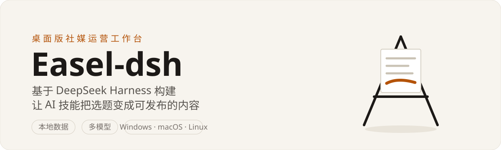
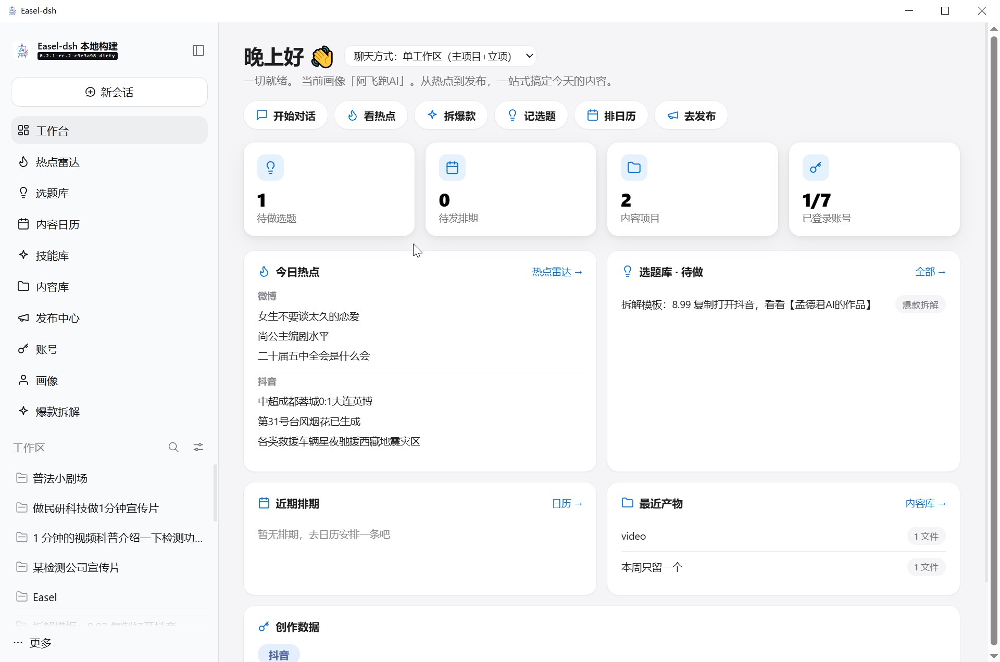
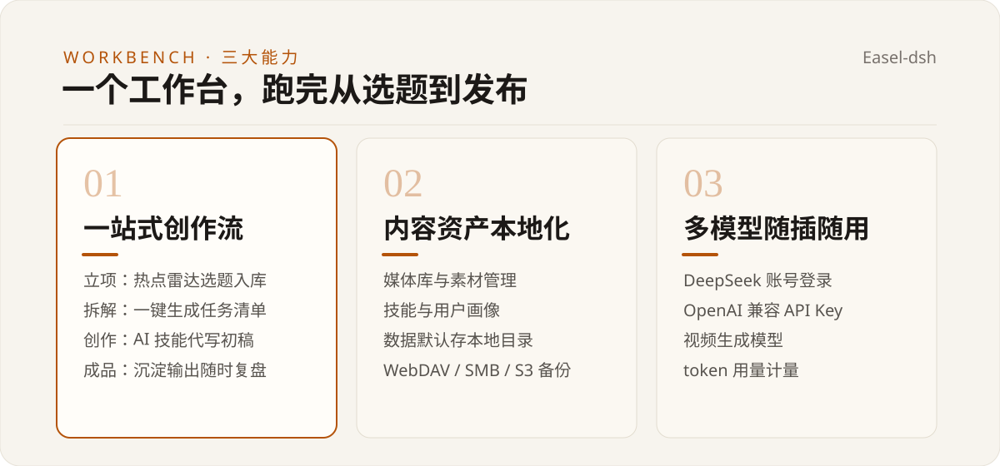

# Easel-dsh

中文 | [English](README-en.md)

<div align="center">



[](LICENSE) [](#从源码构建) [](#安全须知)

</div>

Easel-dsh 是基于 [DeepSeek Harness](https://github.com/deepseek-ai/deepseek-harness) 构建的桌面版社媒运营工作台：把选题、拆解、AI 创作、排期、发布收进一个本地优先的桌面应用，由可组合的 agent 技能驱动。

> 灵感来源 [ZJU-REAL/Easel](https://github.com/ZJU-REAL/Easel)，技术底座 [deepseek-harness](https://github.com/deepseek-ai/deepseek-harness)，感谢两个上游项目。



## 功能一览

| 模块 | 能力 |
|---|---|
| 创作流 | 立项（创意入库）、拆解（任务清单）、AI 技能创作、成品库 |
| 情报 | 热点雷达（跨平台热点聚合、关注词、正文抓取）、内容日历（节假日底图、CalDAV 订阅） |
| 资产 | 媒体库、技能、用户画像；数据默认存本地，设置页可改数据位置并迁移 |
| 跨设备 | 隔空传送（Air Transfer）：局域网内设备间传送会话、内容库与配置 |
| 平台与模型 | 多账号管理、多模型接入、发布出口 |



## 快速开始

1. 从 [GitHub Releases](https://github.com/laochenfei233/easel-dsh/releases) 下载对应平台的安装包（Windows / macOS / Linux，安装包内嵌 Node 运行时，无需系统环境）。
2. 安装并启动；升级安装无需先卸载旧版本。
3. 在设置页登录 DeepSeek 账号，或填入 API Key 接入其他模型。
4. 新建一个立项，从热点雷达或自己的想法开始第一条内容。

数据默认存放在系统「文档」目录下的 Easel-dsh 文件夹，可在设置页「数据位置」中更改并迁移；支持 WebDAV / SMB / S3 备份。

## 模型接入

- DeepSeek 账号登录，或 API Key 直填设置页。
- OpenAI 兼容接入：内置多服务商 provider 数据（含 MiniMax 等），文本与视频生成模型都可挂载。
- 模型适配层本身是插件，接入新的服务商不需要改核心代码。

## 工作方式


每个功能面都是一个插件：工作台界面、技能加载、模型适配、会话日志互相独立，可单独启停或替换。 agent 在会话中调用技能完成创作任务，全部过程沉淀为可回放的会话日志。

## 架构

Easel-dsh 继承 DeepSeek Harness 的 everything-is-a-plugin 架构：基于 [Cordis](https://github.com/cordiverse/cordis)， 模型适配、工具注册、会话日志乃至 agent 循环本身都是插件，通过 profile / bundle 分层组合，`cordis.yml` 可插可拔。

| 层 | 内容 |
|---|---|
| 桌面壳 | Tauri 窗口 + 内嵌 Node 运行时（`apps/desktop-tauri`） |
| 产品层 | 工作台插件 `easel/dsh-plugin-easel` 与 `@easel-dsh/*` 挂载包 |
| harness 层 | `packages/*/*` 分组：core（agent / 会话）、llm（模型接入）、skill（技能）、client（Web 界面）、shell / terminal（执行）等 |
| 组合层 | bundle / profile：`dsh-base` 打底，桌面应用在其上叠加产品插件 |

完整架构见 [docs/architecture.zh.md](docs/architecture.zh.md)，包分组总览见 [packages/README.zh.md](packages/README.zh.md)。

## 从源码构建

需要 Node.js ^22.19.0 || >=24.0.0 与 pnpm 11：

```sh
git clone https://github.com/laochenfei233/easel-dsh.git
cd easel-dsh
pnpm install
pnpm run build
pnpm run dev:desktop
```

本机打包安装包：

```sh
pnpm run package:desktop:win:x64
pnpm run package:desktop:mac:arm64
```

## 安全须知

Easel-dsh 是开发者预览版（developer preview）。它会执行模型生成的代码与命令、加载第三方插件、访问网络与文件； 沙箱与审批机制可以降低风险，但不等于安全隔离。首次使用前请阅读 [SAFETY.zh.md](SAFETY.zh.md)。

## 贡献与许可

- 参与贡献见 [CONTRIBUTING.zh.md](CONTRIBUTING.zh.md)；版本历史见 [CHANGELOG.md](CHANGELOG.md)。
- 本仓库以 MIT 许可发布（[LICENSE](LICENSE)）；`easel/dsh-plugin-easel` 产品插件为 Apache-2.0；第三方依赖声明见 [THIRD_PARTY_NOTICES.md](THIRD_PARTY_NOTICES.md)。
- 使用 DeepSeek Harness 名称与品牌素材遵循 [BRAND_GUIDELINES.zh.md](BRAND_GUIDELINES.zh.md)。
